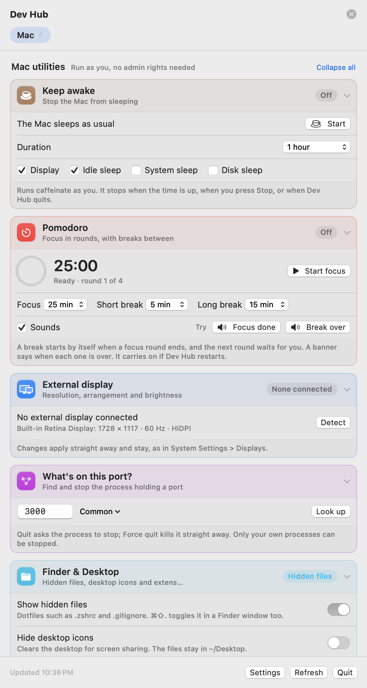
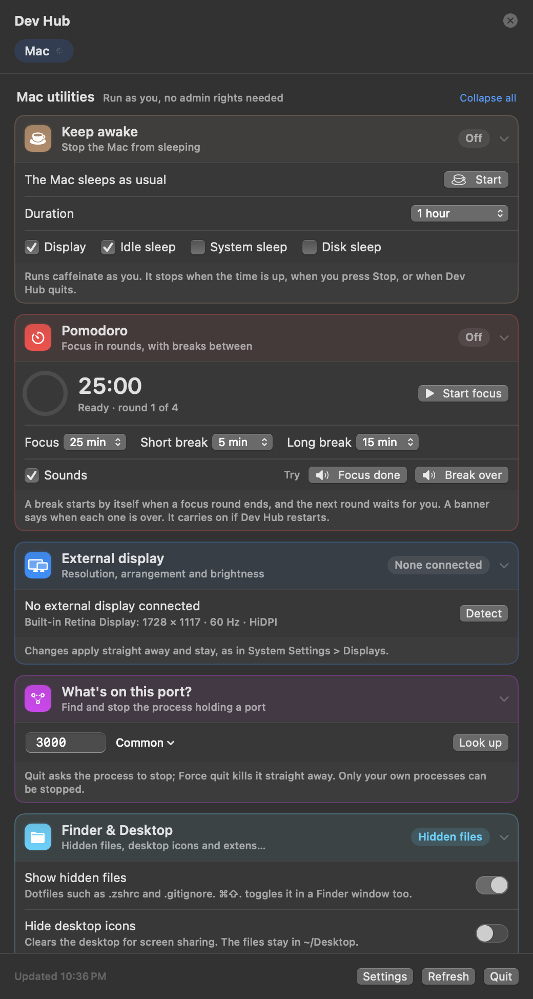
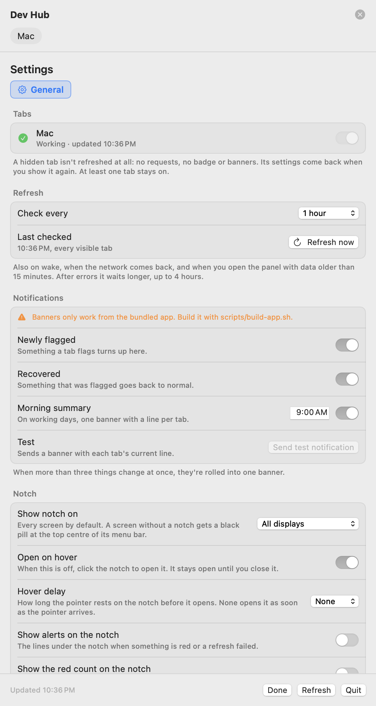
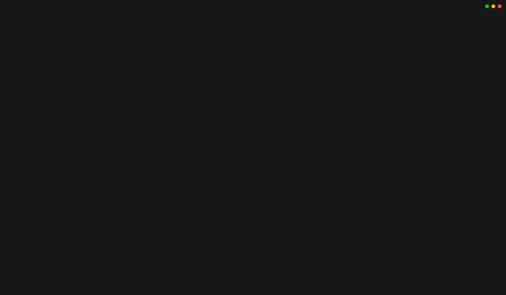

# Dev Hub

[](https://github.com/nthung2112/dev-hub/actions/workflows/ci.yml)
[](https://www.apple.com/macos/)

A macOS notch app for local machine utilities, with no sign-in and nothing leaving the machine.

- **Mac** holds machine utilities that run as you, none of which need admin rights: keep awake, Pomodoro, displays, port lookup, Finder and Desktop switches, screenshot and recording settings, power and disk, dev cache cleanup, and network speed and addresses.
- **Trending** lists the repositories on [github.com/trending](https://github.com/trending), parsed from the public page. Two pickers filter by language (All, TypeScript, JavaScript, Python, Java, Go, Rust) and by period (Daily, Weekly, Monthly).

More tabs can be added without touching the shell.

## Showcase



The notch panel, light and dark.



The Mac tab's settings page.





The `devhub` CLI: status, and the JSON dump of a tab's snapshot.

## What it shows

- **Notch:** hover the top centre of the screen (the camera cutout on a Mac that has one) and Dev Hub opens. A click opens it too. Every connected screen gets one, external displays included: a screen without a notch shows a black pill at the top centre of its menu bar. **Show notch on** in Settings limits it to the main display or one screen; opening one closes the others. It closes when the pointer leaves, or, with Open on Hover off, stays until you press Esc, click outside, or the close button.
  - The closed notch is plain black by default. Turn on **Show alerts on the notch** in Settings, or from the menu bar icon, for a summary under it whenever a tab is red or a refresh failed, and the Keep Awake line when that's running. Nothing hangs there when everything is clean, and a full-screen app collapses it to one line.
  - In Settings you can show the red count at the top of that alert.
  - **Live activity:** a refresh you start (Refresh, ⌘R, Refresh now, or a settings change), and the first one when Dev Hub starts, widens the closed notch on both sides of the camera, like the Dynamic Island: a turning arrow on the left, and a progress ring with how many tabs have answered (`1/1`) on the right. When it finishes it shows **Done**, or how many tabs failed in orange, for a moment, then shrinks back. Later refreshes on the schedule, on wake or when the network returns stay quiet.
  - While **Keep Awake** is on, the same ears show an orange cup and the time left, counting down (`59:58`), or **Awake** when it runs until stopped. A refresh you start takes the ears while it runs, then Keep Awake comes back. Stopping it, or its timer running out, shrinks the notch back.
  - While a **Pomodoro** runs (the Mac tab's Pomodoro section), the ears show a red timer during focus, a green leaf during a break or an orange pause, with a ring that fills and the time left counting down (`24:13`). It takes the ears from Keep Awake; a refresh you start still comes first.
  - **More than one at once:** like the Dynamic Island, the first activity (a refresh you started, then the Pomodoro, then Keep Awake) takes the ears and each other one shows as a small black bubble just right of the notch, with its icon and progress ring. Click a bubble to move it into the ears: the two icons trade places, and your pick stays there until it ends. Resting on a bubble doesn't open the panel; the bubbles hide while it's open.
- **Pomodoro** (in the Mac tab): **Start focus** runs a focus round (25 minutes by default), then a short break (5) starts by itself, with a long break (15) after every fourth round. The next round waits for you. **Pause**, **Resume**, **Skip** and **Stop** (back to round 1), and the three lengths, are in the section. A banner says when each focus round or break is over. **Sounds** (on by default) plays the Mac's Glass chime when a focus round ends, Hero when a break ends, and a soft Tink when one starts or resumes; the banner is silent while they're on, and the **Try** buttons play each chime. It carries on if Dev Hub restarts, and a phase that ended while the Mac slept moves on at wake.
  - The menu bar icon only opens a menu: Settings, Show Alerts on the Notch, Launch at Login and Quit.
- **Panel (the open notch):**
  - A tab strip at the top. Each tab shows a red dot and count when it has red items, or an orange dot when a refresh failed. ⌘1…⌘9 switch tabs, and the tab you last picked opens next time.
  - **Settings** has a General page and one page per visible tab, picked from a strip at the top whose dots show each tab's health (green working, red failed).
  - **Tabs** on the General page lists every tab with its health, a shortcut to its settings page, and a switch to show or hide it. A hidden tab is switched off, not just out of sight: it isn't refreshed, doesn't count towards the notch alert, banners or morning summary, and its settings page is hidden. Showing it again loads it straight away. At least one tab always stays on.
  - Settings, Refresh and Quit in the footer. Esc or the close button closes the panel. The middle scrolls when it would be taller than the screen.
- **Mac tab** (machine utilities):
  - **Keep awake:** the `caffeinate` options you tick (prevent sleep, prevent disk sleep, prevent display sleep, prevent the system from going idle) and how long it runs for, or until you stop it. The notch shows the cup and the time left while it's on.
  - **Pomodoro:** as described above.
  - **External displays:** the ones connected, their resolution and refresh rate, the arrangement canvas you drag them around in, brightness for each external monitor, and the arrangement's mirrored state.
  - **What's on this port?:** type a port and it finds the process holding it, with the PID and a copy button for the kill command.
  - **Finder & Desktop:** show hidden files, hide desktop icons and show all file extensions, plus a restart for Finder or the Dock.
  - **Screenshots & recording:** where captures go (Desktop, Pictures, Documents, Clipboard or a folder you pick), the format, the timer, and the window shadow and floating thumbnail switches.
  - **Power & screen:** the battery's charge, state and time remaining, free disk space, and quick actions.
  - **Dev caches:** the size of the Xcode, Yarn and Gradle caches, and a button to clear them.
  - **Network:** the current speed in and out, the local IP address, the Wi-Fi name and your SSH public key, each with a copy button, plus a speed test.
- **Trending tab** (github.com/trending):
  - The repositories on the page, in the order it lists them: the rank, `owner/name`, the description, the language, total stars, forks and the stars gained over the period. Click a row to open the repository on GitHub.
  - **Language** picks All languages, TypeScript, JavaScript, Python, Java, Go or Rust. **Period** picks Daily, Weekly or Monthly. The pair sets the page that is read, e.g. `github.com/trending/typescript?since=weekly`, and is remembered between launches.

## Requirements

- macOS 14 or later
- Xcode or the Xcode Command Line Tools

## Install

Build it locally. The app is deliberately not code-signed: on managed Macs an ad-hoc `codesign` signature gets blocked, while a locally built binary that keeps only the linker's signature runs.

```bash
cd dev-hub
./scripts/build-app.sh --install
ln -sf "$PWD/scripts/devhub" ~/bin/devhub   # any directory on your PATH
devhub start
```

Allow notifications when macOS asks. Then press **Send test notification** in Settings.

### `devhub` command

| Command | What it does |
|---|---|
| `devhub` / `devhub start` | Launch the app |
| `devhub stop` | Quit it |
| `devhub restart` | Quit and relaunch |
| `devhub status` | Show whether it's running |
| `devhub install` | Rebuild from this repo, reinstall, and launch |
| `devhub dump [tab]` | Refresh and print the tabs' snapshots as JSON (every visible tab by default; name a hidden tab to dump it anyway) |

### Launch at login

Enable it under Settings. It writes `~/Library/LaunchAgents/local.devhub.plist` and takes effect at your next login.

## How data is fetched

The Mac tab reads the machine's own state with the tools macOS ships: `pmset -g batt` for the battery, `df` for the disk, `system_profiler` and `defaults` for the displays and Finder and screenshot settings, `lsof` for the port lookup, and `networkQuality` for the speed test. Nothing needs admin rights, nothing leaves the Mac, and no tab needs a token or a sign-in.

The Trending tab is the one that uses the network: it fetches the public `github.com/trending` page and reads it. No sign-in, no token, no personal data sent.

A refresh runs every 60 minutes (15 minutes to 4 hours in Settings), on wake from sleep, when the network comes back, and when you open the panel with data older than 15 minutes. After errors it backs off, doubling the interval up to 4 hours, and it never polls more than once a minute.

## Adding a tab

The shell only talks to the `Monitor` protocol (`Sources/DevHubCore/Shared/Monitor.swift`). A new tab is:

1. A folder `Sources/DevHubCore/<Name>/` with a type conforming to `Monitor`. Its `refresh()` returns a `MonitorSnapshot`: a status, a tooltip line, the items that notifications diff, and any detail its view needs.
2. A view in `Sources/DevHub/Views/<Name>View.swift` taking a `TabState`, plus an optional settings view.
3. One line in `MonitorRegistry.tabs` (`Sources/DevHub/MonitorRegistry.swift`).

The badge, tab strip, scheduling, notifications, Settings and `--dump` pick it up from there. `HubTests.anyMonitorDrivesTheBadgeDiffAndDump` runs a dummy monitor through that machinery. To show tabs in one strip entry, add a `TabGroup` to `MonitorRegistry.groups`: each member keeps its own monitor, settings page and switch, and the members' views decide how they share the space.

## Development

```bash
xcrun swift build
xcrun swift test
xcrun swift run --disable-get-task-allow-entitlement DevHub --dump utilities
xcrun swift run --disable-get-task-allow-entitlement DevHub --render /tmp/panel.png utilities   # add --settings (that tab's settings page, or General without a tab) or --dark
```

Use `xcrun swift`, not plain `swift`. On a machine where `swift` on PATH comes from Command Line Tools but Xcode is selected, plain `swift test` fails because the Swift Testing macro versions don't match.

Debug builds get the `get-task-allow` entitlement, and managed Macs kill binaries that carry it as soon as they launch. Pass `--disable-get-task-allow-entitlement` to run a debug build, or use a release build as `build-app.sh` does.

`--render` refreshes every tab and draws the panel offscreen to a PNG, which is handy for checking layout without opening the notch. It leaves banners and the last-seen state alone.

Tests never call a network service. The Mac tab's parsers are tested against made-up command output.

| Path | Contents |
|---|---|
| `Sources/DevHubCore/Shared/` | `Monitor` protocol, badge rule, refresh schedule, tab visibility and groups, formatting, `--dump` encoding |
| `Sources/DevHubCore/Notifications/` | Last-seen state, per-tab diff, reminders and banner text |
| `Sources/DevHubCore/Utilities/` | Caffeinate, Pomodoro, displays and brightness, port lookup, screenshot settings, machine state, network speed, dev cache cleanup |
| `Sources/DevHubCore/Trending/` | GitHub trending page: the monitor, the HTML parser and the repositories |
| `Sources/DevHubCore/Notch/` | Notch geometry, activity feed, full-screen detection |
| `Sources/DevHub/` | AppKit app: notch, menu bar menu, tab registry, store, panel and settings, notifications, `--dump`, `--render` |
| `Tests/DevHubTests/` | Unit tests |
| `scripts/build-app.sh` | Builds and installs the `.app` bundle |
| `scripts/devhub` | Launcher: start, stop, status, install, dump |
| `scripts/setup.sh` | Checks the toolchain, builds, runs the tests |
| `scripts/capture.sh` | Renders the showcase images from the app |
| `scripts/demo.tape` | VHS tape for the CLI demo |
